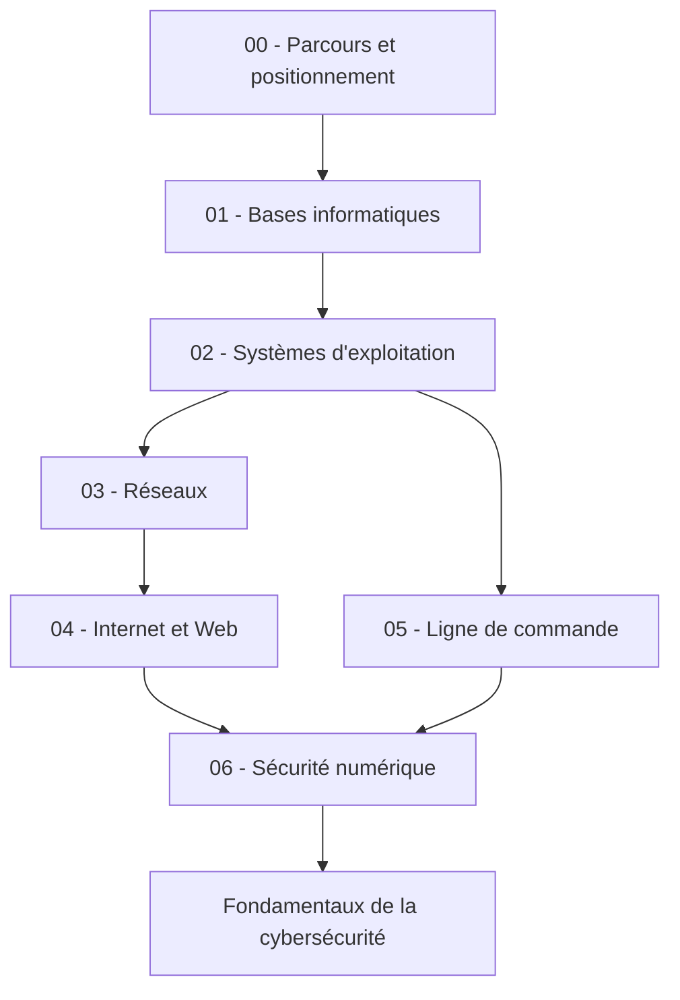

# HashCode Foundations

> Le socle de connaissances informatiques pour préparer les apprenants de HashCode aux fondamentaux de la cybersécurité.

## Objectif

Ce dépôt rassemble des cours progressifs, des exercices guidés, un glossaire et des évaluations de positionnement. Il doit aider les apprenants à acquérir les bases nécessaires sans exiger une expérience préalable en programmation ou en administration système.

## Parcours pédagogique

1. **Bases de l'informatique** — matériel, CPU, RAM, stockage, fichiers et applications.
2. **Systèmes d'exploitation** — Windows et Linux, utilisateurs, permissions, processus et mises à jour.
3. **Réseaux informatiques** — LAN, adresses IP, routeurs, ports, TCP/UDP et modèle client-serveur.
4. **Internet et Web** — DNS, domaines, HTTP/HTTPS, serveurs Web et certificats TLS.
5. **Ligne de commande** — navigation, manipulation de fichiers et inspection de base du système.
6. **Sécurité numérique** — authentification, mots de passe, phishing, malwares, sauvegardes et mises à jour.

## Architecture du dépôt

```text
hashcode-foundations/
├── README.md
├── CONTRIBUTING.md
├── CODE_OF_CONDUCT.md
├── LICENSE
├── docs/
│   ├── 00-learning-path/       # Vue d'ensemble, objectifs et prérequis
│   ├── 01-computer-basics/     # Matériel et concepts informatiques
│   ├── 02-operating-systems/   # Windows, Linux et permissions
│   ├── 03-networking/          # Réseaux, IP, ports et protocoles
│   ├── 04-internet-and-web/    # DNS, HTTP(S), Web et TLS
│   ├── 05-command-line/        # Terminal et commandes élémentaires
│   └── 06-security-basics/     # Hygiène numérique et risques courants
├── glossary/                   # Définitions courtes et cohérentes
├── exercises/                  # Exercices pratiques guidés
├── assessments/                # Quiz et tests de positionnement
├── resources/                  # Références et ressources complémentaires
└── .github/
    ├── ISSUE_TEMPLATE/         # Modèles d'issues
    └── PULL_REQUEST_TEMPLATE.md
```

## Structure d'un chapitre

Chaque chapitre doit, autant que possible, contenir :

- `README.md` : objectifs, notions, explications et synthèse ;
- `glossary.md` : termes propres au chapitre ;
- `exercises.md` : exercices progressifs avec consignes et résultats attendus ;
- `quiz.md` : questions de vérification ;
- `resources.md` : sources fiables et lectures complémentaires.

Ne crée pas mécaniquement tous ces fichiers si le contenu n'est pas utile : la clarté pédagogique prime sur la quantité de fichiers.

## Principes pédagogiques

- **Accessible aux débutants** : expliquer chaque terme technique avant de l'utiliser.
- **Progressif** : partir des concepts simples et relier chaque chapitre au suivant.
- **Pratique** : proposer des exercices vérifiables sur un poste personnel ou un environnement de laboratoire.
- **Sécurisé et légal** : toute expérimentation réseau ou sécurité doit être réalisée sur des systèmes appartenant à l'apprenant ou avec une autorisation explicite.
- **Traçable** : citer les sources et indiquer la date de dernière vérification pour les contenus qui évoluent.
- **Contributif** : garder les cours en Markdown, faciles à relire, versionner et améliorer par la communauté.

## Ordre de progression



## Démarrage rapide

1. Lire le parcours pédagogique dans `docs/00-learning-path/`.
2. Passer le test initial dans `assessments/`.
3. Suivre les chapitres dans l'ordre recommandé ou réviser uniquement les lacunes identifiées.
4. Réaliser les exercices avant de passer au quiz du chapitre.

## Langue et format

- Langue principale : français.
- Format : Markdown (`.md`) et schémas textuels Mermaid lorsque cela améliore la compréhension.
- Vocabulaire : donner le terme français puis le terme anglais entre parenthèses lorsqu'il est couramment utilisé dans l'industrie.

## Statut

Architecture initiale. Le contenu pédagogique sera ajouté progressivement, après validation des objectifs et des critères de qualité de chaque chapitre.

## Contribution

Consulter [CONTRIBUTING.md](CONTRIBUTING.md) avant de proposer un nouveau cours, un exercice ou une correction.
